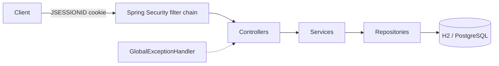

# Personal Finance Manager API

A RESTful backend for tracking income and expenses, organising spending into categories, setting savings goals and generating monthly/yearly reports. Built with **Java 17** and **Spring Boot 3** for the Syfe Backend Assignment, with session-based authentication and strict per-user data isolation.

## Live Deployment & Repository

| | |
|---|---|
| **GitHub repository** | https://github.com/subhamjha1/personal-finance-manager |
| **Live API (Render)** | https://personal-finance-manager-3bx5.onrender.com |
| **Health check** | https://personal-finance-manager-3bx5.onrender.com/actuator/health → `{"status":"UP"}` |

> The service runs on Render's free tier, so the first request after a period of inactivity may take a while (cold start).

## Key Features

- **Authentication & security** – registration and login, server-side sessions with a `JSESSIONID` cookie, BCrypt password hashing, logout that invalidates the session. Every endpoint except register, login, health and API docs requires authentication.
- **User data isolation** – the user is always taken from the authenticated session, never from the request; all queries are scoped to that user.
- **Transactions** – create, list (with filters), update and delete income/expense transactions. The type (`INCOME`/`EXPENSE`) is derived from the chosen category.
- **Categories** – seven shared default categories plus per-user custom categories. Default categories cannot be deleted, and a category used by any transaction cannot be deleted.
- **Savings goals** – create, list, get, update and delete goals with calculated progress, progress percentage and remaining amount.
- **Reports** – monthly and yearly income/expense totals per category with net savings.
- **Validation & errors** – Bean Validation on all inputs and a uniform JSON error body with no stack traces.
- **Money handling** – `BigDecimal` throughout, at most 2 decimal places.

## Technology Stack

| Area | Technology |
|---|---|
| Language / framework | Java 17, Spring Boot 3.3.5 |
| Security | Spring Security (session cookies, BCrypt) |
| Persistence | Spring Data JPA / Hibernate; PostgreSQL (deployed, `prod` profile); H2 in-memory (default local profile and tests) |
| Validation | Jakarta Bean Validation |
| API docs | springdoc OpenAPI / Swagger UI |
| Build | Maven |
| Testing | JUnit 5, Mockito, Spring Boot Test, MockMvc, Spring Security Test |
| Coverage | JaCoCo |
| Packaging / hosting | Docker (multi-stage), Render |

## Architecture



**Request flow:** the security filter chain restores the user from the session cookie → a controller validates the request DTO and passes the authenticated user's id to a service → the service applies business rules → Spring Data repositories read/write the database → the result is mapped back to a response DTO. Errors are converted into a consistent JSON body by `GlobalExceptionHandler` (and `JsonSecurityErrorHandler` for 401/403 raised by the security chain).

**Packages** (`com.syfe.pfm`): `config` (clock, default-category seeding), `security`, `controller`, `service`, `repository`, `entity`, `dto`, `exception`.

**Data model:** `User`, `Category` (default categories have no owner; custom categories belong to one user), `Transaction` (user + category), `SavingsGoal` (user).

**Design notes**
- Goal progress and reports are computed on demand from stored transactions, so they always reflect creates, updates and deletes.
- CSRF token protection is intentionally disabled (JSON-only API for non-browser clients); this is mitigated by `SameSite=Lax`, `HttpOnly` cookies (and `Secure` in production) and JSON-only request bodies. See `SecurityConfig`.
- Default categories are seeded idempotently at start-up.

## API Endpoints

Base path: `/api`. All request/response bodies are JSON.

| Method | Path | Auth | Description |
|---|---|---|---|
| POST | `/api/auth/register` | No | Register a user (`201`) |
| POST | `/api/auth/login` | No | Log in and receive a session cookie |
| POST | `/api/auth/logout` | Yes | Invalidate the session and expire the cookie |
| GET | `/api/categories` | Yes | List default + the user's custom categories |
| POST | `/api/categories` | Yes | Create a custom category (`201`) |
| DELETE | `/api/categories/{name}` | Yes | Delete a custom category |
| POST | `/api/transactions` | Yes | Create a transaction (`201`) |
| GET | `/api/transactions` | Yes | List transactions, newest first, with optional filters |
| PUT | `/api/transactions/{id}` | Yes | Update a transaction (partial; date cannot change) |
| DELETE | `/api/transactions/{id}` | Yes | Delete a transaction |
| POST | `/api/goals` | Yes | Create a savings goal (`201`) |
| GET | `/api/goals` | Yes | List goals with progress |
| GET | `/api/goals/{id}` | Yes | Get one goal with progress |
| PUT | `/api/goals/{id}` | Yes | Update a goal (partial) |
| DELETE | `/api/goals/{id}` | Yes | Delete a goal |
| GET | `/api/reports/monthly/{year}/{month}` | Yes | Monthly income/expense by category and net savings |
| GET | `/api/reports/yearly/{year}` | Yes | Yearly income/expense by category and net savings |
| GET | `/actuator/health` | No | Health check (only actuator endpoint exposed) |
| GET | `/swagger-ui.html`, `/v3/api-docs` | No | Swagger UI / OpenAPI document |

**Transaction list filters** (all optional, combinable): `startDate`, `endDate` (inclusive, `yyyy-MM-dd`), `categoryId` (numeric), `category` (name, case-insensitive), `type` (`INCOME` or `EXPENSE`).

### Behaviour and validation rules

| Area | Rules (as implemented) |
|---|---|
| Registration | `username` must be a valid email (stored lower-case, unique → `409` if taken); `password` 8–72 characters; `fullName` required (max 100); `phoneNumber` required, with an optional leading `+` followed by 7–15 digits |
| Transactions | `amount` > 0 with at most 2 decimals; `date` required and not in the future; `category` must exist and be visible to the user (otherwise `400`); `description` optional (max 500). On update, omitted fields are kept and sending a *different* `date` returns `400` |
| Categories | Names are unique, case-insensitively, among the categories visible to the user (defaults + own). Different users may use the same custom name. Deleting: `404` if not found, `403` for a default category, `400` if any transaction uses it |
| Goals | `goalName`, `targetAmount` (> 0) and `targetDate` required; `startDate` defaults to today and cannot be changed later; `targetDate` must be in the future and after `startDate`. Accessing another user's goal returns `403` (`404` if it does not exist) |
| Transactions of other users | Return `404` |
| Goal progress | `currentProgress` = total income − total expenses for transactions dated on or after the goal's `startDate`; `progressPercentage` = progress × 100 / target; `remainingAmount` = target − progress. Values are not capped, so progress can be negative or exceed 100%. Each goal is calculated independently from its own start date |
| Reports | Calendar-month / calendar-year boundaries, inclusive. Month must be 1–12 and year 1–9999 (otherwise `400`) |

**Default categories:** Salary (income); Food, Rent, Transportation, Entertainment, Healthcare, Utilities (expense).

**Error format**

```json
{
  "status": 400,
  "error": "Bad Request",
  "message": "Validation failed: amount: must be greater than 0",
  "details": ["amount: must be greater than 0"],
  "timestamp": "2026-01-15T10:00:00Z"
}
```

Status codes used: `400` validation/malformed input, `401` unauthenticated or bad credentials, `403` forbidden, `404` not found, `409` duplicate, `405`/`415` for unsupported method/content type, `500` generic (no internal details).

## Authentication & Sessions

1. `POST /api/auth/register` creates the account.
2. `POST /api/auth/login` validates credentials and returns `Set-Cookie: JSESSIONID=...` (`HttpOnly`, `SameSite=Lax`; `Secure` when running with the `prod` profile or `SESSION_COOKIE_SECURE=true`). An existing session id is rotated on login.
3. Send that cookie with every later request. Sessions expire after 30 minutes of inactivity.
4. `POST /api/auth/logout` invalidates the session. Calling it without a valid session returns `401`.

Requests to protected endpoints without a valid session return `401` with the JSON error body.

## Example Requests

The examples use fictitious data. Replace the base URL with `http://localhost:8080` for a local run. `-c`/`-b` store and send the session cookie.

```bash
BASE=https://personal-finance-manager-3bx5.onrender.com

# Register
curl -i -H 'Content-Type: application/json' \
  -d '{"username":"jane@example.com","password":"<your-password>","fullName":"Jane Doe","phoneNumber":"+911234567890"}' \
  $BASE/api/auth/register

# Login (saves the session cookie to jar.txt)
curl -i -c jar.txt -H 'Content-Type: application/json' \
  -d '{"username":"jane@example.com","password":"<your-password>"}' \
  $BASE/api/auth/login

# Create an expense
curl -b jar.txt -H 'Content-Type: application/json' \
  -d '{"amount":500.00,"date":"2026-01-15","category":"Food","description":"Groceries"}' \
  $BASE/api/transactions

# Filter transactions
curl -b jar.txt "$BASE/api/transactions?startDate=2026-01-01&endDate=2026-01-31&type=EXPENSE"

# Create a savings goal
curl -b jar.txt -H 'Content-Type: application/json' \
  -d '{"goalName":"Emergency Fund","targetAmount":100000.00,"targetDate":"2027-12-31","startDate":"2026-01-01"}' \
  $BASE/api/goals

# Reports
curl -b jar.txt $BASE/api/reports/monthly/2026/1
curl -b jar.txt $BASE/api/reports/yearly/2026
```

**Register → `201`**
```json
{ "message": "User registered successfully", "userId": 1 }
```

**Create transaction → `201`**
```json
{ "id": 1, "amount": 500.00, "date": "2026-01-15", "category": "Food", "description": "Groceries", "type": "EXPENSE" }
```

**Create goal → `201`** (with only the expense above recorded, progress is negative)
```json
{
  "id": 1, "goalName": "Emergency Fund", "targetAmount": 100000.00,
  "targetDate": "2027-12-31", "startDate": "2026-01-01",
  "currentProgress": -500.00, "progressPercentage": -0.50, "remainingAmount": 100500.00
}
```

**Monthly report → `200`**
```json
{ "month": 1, "year": 2026, "totalIncome": {}, "totalExpenses": { "Food": 500.00 }, "netSavings": -500.00 }
```

## Database & Configuration

By default the app uses an **in-memory H2** database (data is lost on restart) and needs no setup. For PostgreSQL, activate the `prod` profile and provide the connection variables.

| Variable | Default | Purpose |
|---|---|---|
| `PORT` | `8080` | HTTP port (set by Render) |
| `SPRING_PROFILES_ACTIVE` | – | `prod` enables PostgreSQL and the `Secure` cookie flag |
| `DB_HOST`, `DB_PORT`, `DB_NAME`, `DB_USERNAME`, `DB_PASSWORD` | – (`DB_PORT` defaults to `5432`) | PostgreSQL connection (`prod` profile) |
| `DB_URL` | in-memory H2 | Full JDBC URL override (non-`prod` profiles) |
| `SESSION_COOKIE_SECURE` | `false` | Set `true` when served over HTTPS |
| `APP_TIMEZONE` | `UTC` | Time zone used to decide "today" (future-date checks, default goal start date) |
| `DDL_AUTO` | `update` | Hibernate schema mode |

`.env.example` documents these variables with placeholders only. Never commit a real `.env` (it is git-ignored). Tables are created by Hibernate (`ddl-auto=update`); there are no migration scripts.

## Local Setup

**Prerequisites:** JDK 17+ and Maven 3.9+ (check with `java -version` and `mvn -v`). Docker is only needed for the container build.

```bash
git clone https://github.com/subhamjha1/personal-finance-manager.git
cd personal-finance-manager
mvn spring-boot:run          # http://localhost:8080
```

On **Windows (PowerShell)**, if `mvn` is not on your `PATH`, call the Maven launcher directly:

```powershell
& "<path-to-maven>\bin\mvn.cmd" spring-boot:run
```

Alternatively, build and run the jar (the artifact is named `app.jar`):

```bash
mvn clean package
java -jar target/app.jar
```

Swagger UI: `http://localhost:8080/swagger-ui.html` · Health: `http://localhost:8080/actuator/health`

**Docker (optional):**

```bash
docker build -t personal-finance-manager .
docker run -p 8080:8080 personal-finance-manager
```

## Build & Test

```bash
mvn clean verify
```

On Windows PowerShell, with a Maven that is not on `PATH`: `& "<path-to-maven>\bin\mvn.cmd" clean verify`.

`verify` compiles, runs all tests, generates the JaCoCo report and enforces the coverage gate configured in `pom.xml` (minimum **80% line coverage**, bundle level).

## Test Results & Coverage

| Check | Result |
|---|---|
| Maven `clean verify` | `BUILD SUCCESS` |
| Automated tests | **87 executed – 0 failures, 0 errors, 0 skipped** |
| JaCoCo coverage check | Passed |
| Coverage report | `target/site/jacoco/index.html` (generated by `mvn clean verify`) |

The automated suite has two layers:

- **Integration tests** (`@SpringBootTest` + MockMvc, H2, real security filter chain): authentication, categories, transactions, goals and reports.
- **Unit tests** (JUnit 5 + Mockito): auth, category, transaction, goal and report services.

### Manual API smoke tests (deployed service)

Using PowerShell with an authenticated session against the Render deployment, the following succeeded: user registration and login; retrieving default categories; creating, retrieving and updating a transaction; creating and retrieving a savings goal; generating monthly and yearly reports (the ₹500 Food expense was reflected as −₹500 net savings); and an unauthenticated request to a protected endpoint returned `401`.

These were targeted smoke tests, not an exhaustive verification of every endpoint or deployment setting.

## Deployment

- **Platform:** Render (Docker web service), backed by PostgreSQL in the deployed environment.
- **Files:** `Dockerfile` (multi-stage Maven → JRE 17 build, runs as a non-root user), `render.yaml` (Render Blueprint defining the web service and a PostgreSQL database), `application-prod.properties`.
- **Health check:** `/actuator/health` (configured as the Render `healthCheckPath`). The deployed endpoint returned `{"status":"UP"}`.
- **Configuration:** database credentials and profile settings are supplied through environment variables, not committed to the repository.

## Limitations & Verification Notes

- **Official assignment script not run.** The assignment refers to `financial_manager_tests.sh`, but that script was not included in the materials received, so it has **not been executed** and no result is claimed. The results above come only from the Maven test suite and the manual smoke tests described.
- **Goal progress can be negative or above 100%.** This follows the assignment's definition (income minus expenses since the goal's start date) and values are intentionally not capped.
- Several unspecified edge cases (for example `403` vs `404` for other users' goals/transactions, case-insensitive category names, rejection of future-dated transactions) are documented implementation decisions and may differ from an external test harness.
- No database migration tooling (schema managed by Hibernate `ddl-auto=update`).
- Sessions are stored in memory on a single instance; there is no rate limiting or account lockout.
- Render's free tier cold-starts after inactivity, and free PostgreSQL instances may expire.

## Author

**Subham Jha** – [github.com/subhamjha1](https://github.com/subhamjha1)
