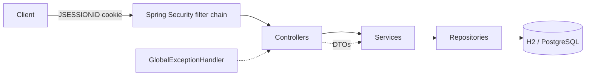

# Personal Finance Manager API

> ## ⚠️ STATUS: UNVERIFIED
> This project was written in an environment with **no Maven, no `javac` and no network access**. It has **never been
> compiled, tested, run, measured for coverage, executed against `financial_manager_tests.sh`, or deployed.**
> Treat every claim below as *intended behaviour* until you complete the steps in
> [Verify locally](#verify-locally). Expect to fix a few compile or test issues on the first run.

REST backend for the Syfe Backend Intern assessment: user registration/login with server-side sessions,
transactions, categories, savings goals, and monthly/yearly reports, with strict per-user data isolation.

## Tech stack
Java 17 · Spring Boot 3.3.5 · Spring Security (session cookies, BCrypt) · Spring Data JPA/Hibernate ·
H2 (default) / PostgreSQL (prod profile) · Bean Validation · JUnit 5 + Mockito + MockMvc · JaCoCo · springdoc (Swagger UI) · Maven · Docker.

## Architecture

Packages under `com.syfe.pfm`: `config` (Clock, default-category seeding), `security`, `controller`, `service`,
`repository`, `entity`, `dto` (records), `exception`.

## Prerequisites
JDK 17+ and Maven 3.9+ (`mvn -v`). Docker only for the container build.

## Run locally
```bash
mvn clean verify            # build + tests + JaCoCo gate
mvn spring-boot:run         # http://localhost:8080 (in-memory H2, data lost on restart)
# or
java -jar target/app.jar
```
Swagger UI: `http://localhost:8080/swagger-ui.html` · Health: `http://localhost:8080/actuator/health`

## Configuration (environment variables)
| Variable | Default | Purpose |
|---|---|---|
| `PORT` | 8080 | HTTP port (Render sets it) |
| `SPRING_PROFILES_ACTIVE` | – | `prod` → PostgreSQL + Secure cookie |
| `DB_HOST` `DB_PORT` `DB_NAME` `DB_USERNAME` `DB_PASSWORD` | – | PostgreSQL (prod profile) |
| `DB_URL` | in-memory H2 | Full JDBC URL override (non-prod profile) |
| `SESSION_COOKIE_SECURE` | false | Set `true` when served over HTTPS (always true in `prod`) |
| `APP_TIMEZONE` | UTC | Zone used for "today" |
| `DDL_AUTO` | update | Hibernate schema mode |

See `.env.example`. No secrets are committed. The H2 console is disabled.

## Authentication & cookies
```bash
curl -i -c jar.txt -H 'Content-Type: application/json' \
  -d '{"username":"user@example.com","password":"password123","fullName":"John Doe","phoneNumber":"+1234567890"}' \
  http://localhost:8080/api/auth/register
curl -i -c jar.txt -H 'Content-Type: application/json' \
  -d '{"username":"user@example.com","password":"password123"}' http://localhost:8080/api/auth/login
curl -b jar.txt http://localhost:8080/api/categories
curl -b jar.txt -X POST http://localhost:8080/api/auth/logout
```
Login creates a server-side session (30 min idle timeout) and the `JSESSIONID` cookie (`HttpOnly`, `SameSite=Lax`,
`Secure` in production). The session id is rotated if one already exists. Logout invalidates the session and expires the cookie.
**CSRF:** Spring's token-based CSRF is intentionally disabled (non-browser JSON API); mitigated by `SameSite=Lax`
cookies and JSON-only bodies. See `SecurityConfig` Javadoc.

## Endpoints
Full contract: [`docs/API_CONTRACT.md`](docs/API_CONTRACT.md). Summary:
`POST /api/auth/{register,login,logout}` · `GET|POST /api/categories`, `DELETE /api/categories/{name}` ·
`GET|POST /api/transactions`, `PUT|DELETE /api/transactions/{id}` · `GET|POST /api/goals`,
`GET|PUT|DELETE /api/goals/{id}` · `GET /api/reports/monthly/{year}/{month}`, `GET /api/reports/yearly/{year}`.

Example – create transaction:
```json
POST /api/transactions   {"amount":50000.00,"date":"2024-01-15","category":"Salary","description":"January Salary"}
201  {"id":1,"amount":50000.00,"date":"2024-01-15","category":"Salary","description":"January Salary","type":"INCOME"}
```

## Validation & errors
Uniform JSON error body (`status`, `error`, `message`, `details`, `timestamp`); no stack traces. 400 validation/malformed input,
401 unauthenticated/bad credentials, 403 forbidden (default category delete, other user's goal), 404 not found,
409 duplicates. Unknown exceptions produce a generic 500 without details.

## Design decisions & assumptions
See [`docs/REQUIREMENTS.md`](docs/REQUIREMENTS.md) (A1–A18). Highlights: `BigDecimal` money; default categories are shared
rows with no owner and are seeded at start-up; goal progress and reports are computed on demand (never stale);
transaction type is derived from the category; goal `403` vs transaction `404` for foreign resources.

## Tests & coverage
```bash
mvn clean verify                    # runs all tests; fails if line coverage < 80 %
open target/site/jacoco/index.html  # coverage report
```
Official script (not included in this repo; supply your copy):
`bash financial_manager_tests.sh http://localhost:8080/api`

## Deployment (Render)
**Prepared by the agent:** `Dockerfile`, `render.yaml`, `application-prod.properties`, health check `/actuator/health`.
**Needs your accounts/actions:**
1. Push the repo to a public GitHub repository.
2. Render → *New → Blueprint* → select the repo (creates the web service + PostgreSQL from `render.yaml`).
   Alternative without a database: create a Docker web service and omit `SPRING_PROFILES_ACTIVE` (in-memory H2; data lost on restart) and set `SESSION_COOKIE_SECURE=true`.
3. Wait for the first deploy (free instances cold-start slowly), then run the official script against `https://<service>.onrender.com/api`.

Live URL: **not deployed / not verified.**

## Known limitations
- Unverified build (see top). No Flyway migrations (`ddl-auto=update`). Free Render PostgreSQL may expire.
- Sessions are in-memory per instance (single instance only). No rate limiting / account lockout.
- Behaviour for ambiguous cases is my interpretation; the official test script may disagree (see A1–A8).
